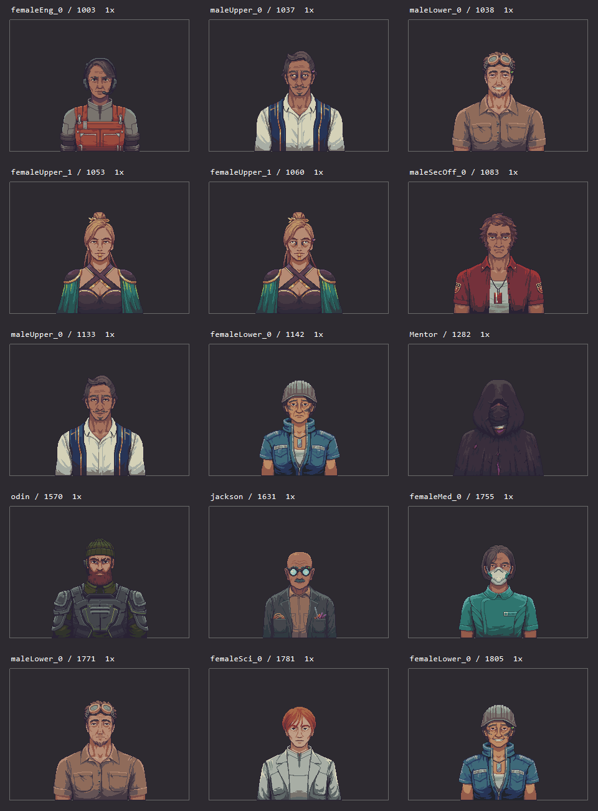
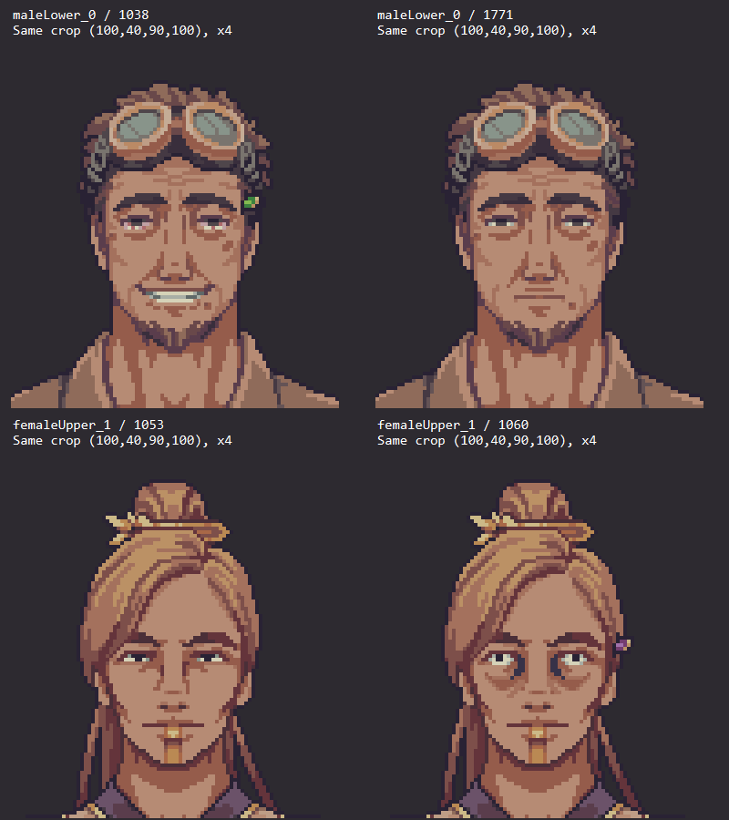
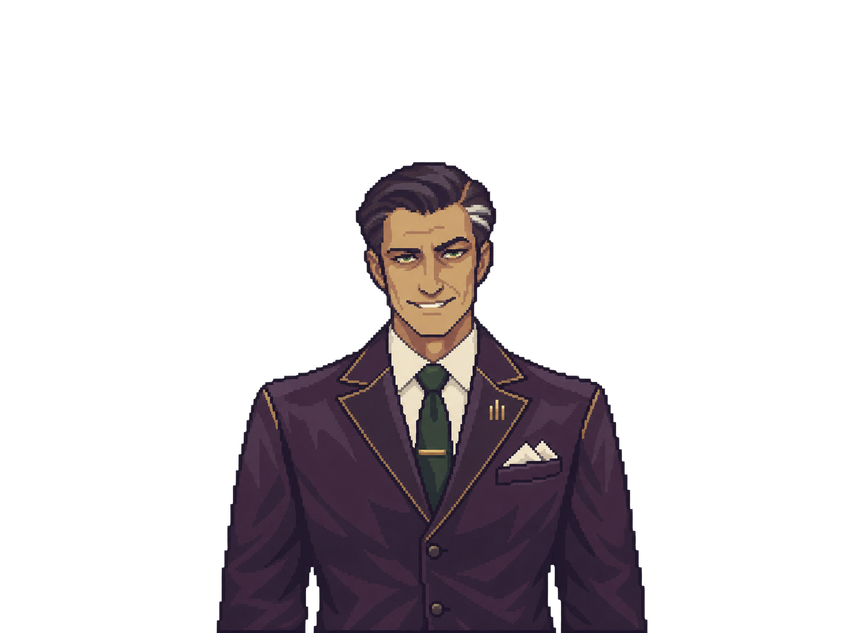

# 人物立绘分析与制作标准

2026-11-05。**公司MOD人物以撒该为主要风格标准，原版人物用于显示适配和世界观协调。** 保留MOD自己的服装设计、面部塑造与材质细节，不要求把所有人物简化为原版低色数立绘。

> 本页中的“当前”及0.9.6路径指分析时的固定快照，不表示GitHub主分支仍为0.9.6。参考副本不自动替换运行时人物资源。

本页优先于物品文档中的16像素占格、8～16色等不适用于人物的规则。属于分析和未来制作要求，本次没有更改任何运行时立绘、滤波或相机设置。

## 一、样本与证据

原版样本来自 `sharedassets1.assets`，SHA256：

`7F716F0598E405439636462AE9804813E43045160163953E9148D0DB207B8E88`

按人物相关名称的初步导出得到154个288×211的PNG文件，此外还匹配到图标、道具和插图；这不是完整人物数量。导出工具遇到同名对象时会覆盖/跳过甚至竞争写文件，因此不使用这些文件名直接作最终证据。

后续按**资源名＋PathID**分别导出11个人物名称对应的15个Sprite对象。完整尺寸、PPU、pivot、来源图集、文件哈希见 [selected/manifest.json](evidence/portraits/selected/manifest.json)，分析以这些唯一文件为准。相同名字确实可以对应不同表情图，不能以名字去重。

撒该参考是当前 `CorpPresence-0.9.6/src/Assets/CorpPresence.portraits.malice_envoy_*.png` 的6张原始文件副本，保存在 [envoy目录](evidence/portraits/envoy)。统计分别使用Alpha≥128作为主体口径，另保留完整Alpha分布；颜色数不是人工设计色板数。

原版统计：[portrait-metrics.json](evidence/portraits/portrait-metrics.json)。撒该统计：[envoy-metrics.json](evidence/portraits/envoy-metrics.json)。代码与输入版本见 [provenance.json](evidence/portraits/provenance.json)。

## 二、原版决定“人物站在哪里、显示多大”



这15个Sprite均为 **288×211、PPU=100、pivot=(0.5,0.5)**。它们不是16像素库存格的整数倍，也不是全身站姿图。

| 原版样本／PathID | 主体RGB数 | 主体包围盒，含端点 | 可借鉴特征 |
|---|---:|---|---|
| femaleEng_0／1003 | 27 | (80,60)–(208,210) | 工作服大分区、背带和耳部设备建立职业识别 |
| maleLower_0／1771 | 24 | (69,50)–(220,210) | 护目镜、衬衣和脸部线条，保持生活感 |
| femaleLower_0／1142 | 29 | (80,57)–(209,210) | 帽子、蓝色夹克和明显领口形成层次 |
| maleUpper_0／1133 | 23 | (72,49)–(217,210) | 浅色衬衣和深色服装边缘，较整洁的职业形象 |
| femaleUpper_1／1053 | 25 | (74,47)–(213,210) | 发髻、披肩和金色饰边，用服饰轮廓说明地位 |
| maleSecOff_0／1083 | 23 | (71,48)–(217,210) | 制服、徽章及项链，正面上半身姿态 |
| femaleMed_0／1755 | 24 | (80,61)–(208,210) | 口罩、制服和小标识，不依赖大面积医疗符号 |
| femaleSci_0／1781 | 20 | (76,60)–(212,210) | 白外套与灰色内衬，发型区别身份 |
| Mentor／1282 | 14 | (71,56)–(216,210) | 连续兜帽轮廓、低亮度大色块、面部信息克制 |
| odin／1570 | 18 | (66,50)–(222,210) | 帽子、胡须和分块护甲形成识别 |
| jackson／1631 | 32 | (85,72)–(204,210) | 圆镜、头型、衣袋工具；主体较小、头顶更低 |

### 构图和裁切

- 画布统一，主体却只占约18%～25%的像素面积。留白是显示布局的一部分，不是应自动删除的“无效空间”。
- 样本主体宽120～157像素；头顶距画布上边47～72像素；下缘都到y=210，身体在画布底部截断。不是把每个人裁成紧贴头顶的头像，再放大到充满窗口。
- 多数是接近正面、略有姿态差异的上半身构图；肩部、衣领和头部轴线比全身身高重要。不能用这些半身样本推导统一“几头身”全身比例。
- 头顶高低、肩宽和体型本来就有差异。制作新角色需要与具体参考对齐，不要求所有人的头顶或眼睛机械重合。
- 同一角色的表情差分则应锁定头骨、发际线、颈部、肩线及下缘，避免说话时人物大小或位置跳变。

### 原版的线条和色彩

脸部保留眉弓、鼻梁、眼袋、嘴角等结构，眼睛没有被统一夸张成大面积亮色。脸和衣服使用有形状的色块与短线，头发按发束表达。暗边常带紫/棕色，不能把所有线替换成纯黑；不同肤色、年龄和职业应选相应参考。

本次15个对象的主体RGB数为 **14～36**，但这只是原版抽样，不是MOD的颜色上限。眼睛、徽章、衣褶可用少量像素发挥作用；原尺寸辨识度比放大图里是否有毛发纹理更重要。

## 三、原版表情差分：局部改变，主体保持



对同名对象进行逐像素比较：

| 对象及PathID | 改变RGBA像素 | 改变Alpha像素 | 变化包围盒 |
|---|---:|---:|---|
| maleLower_0：1038→1771 | 127 | 0 | (131,80)–(167,112) |
| maleUpper_0：1037→1133 | 144 | 0 | (131,79)–(169,98) |
| femaleUpper_1：1053→1060 | 171 | 9 | (130,89)–(170,106) |
| femaleLower_0：1142→1805 | 117 | 0 | (131,91)–(169,117) |

变化集中于眼睛、眉毛、嘴等面部区域。femaleUpper的Alpha也有少量变化，所以不能称所有原版表情的Alpha都完全一致。原始统计见 [native-state-diffs.json](evidence/portraits/native-state-diffs.json)。

这些是图像差异证据，本次没有确认每个PathID对应哪条剧情/情绪键。原版 `SpriteDict.ProcessEntriesToDict` 用的是 `SpriteEntry.key`，并非仅用Sprite名字；接入代码时必须核对真实映射。`maleLower_0`这种数字后缀也不能一概解读为表情序号。

## 四、公司MOD的主标准：撒该

主风格参考：[撒该平滑高档图 s3x](evidence/portraits/envoy/CorpPresence.portraits.malice_envoy_s3x.png)。原尺寸构图参考：[s1x](evidence/portraits/envoy/CorpPresence.portraits.malice_envoy_s1x.png)。像素显示分支参考：[n1x](evidence/portraits/envoy/CorpPresence.portraits.malice_envoy_n1x.png)。



**继承的是“人物塑造与绘制方式”，不是让所有人穿紫色西装、佩戴金饰或使用同一种微笑。**

### 1. 气质：体面、克制、带控制感

撒该的笔挺服装、整齐发型和小幅微笑形成职业人士的体面感；偏窄的眼神、眉形和略带不对称的嘴角，让这种友好同时带有审视意味。这是对画面的风格解读，与角色叙事方向相符，不是某个色值可单独产生的效果。

新人物先写清楚“第一眼给人的印象”和“细看后的另一层性格”。可以是干练、疲惫、谨慎、热心或冷淡，依据角色设定决定；不要把撒该的威胁感复制给所有代理人。

### 2. 面部：成年人结构，表情靠细微关系

- 眉眼、鼻梁、颧颊和下颌有明确结构，肤色通过成片明暗表现体积；五官仍然在像素化形状中组织。
- 眼睛与嘴是表情重点。克制的眼睑、眉角与嘴角组合，比增加大面积发光虹膜或夸张张嘴更接近此参考。
- 发型是有方向的发束和剪影。撒该的后梳头发与局部灰白发束提供身份特征，不靠满头独立细丝。
- 保留角色年龄和个性。其他人物可有不同脸型、肤色、发型和体态，不以撒该的五官作为统一模板。

### 3. 服装：用剪裁、层次和少量标记说明身份

撒该的服装关系很清楚：深紫外套、浅色衬衫、深绿领带，辅以金色滚边/领带夹、胸针、口袋巾和纽扣。外套翻领与衬衫领形成连续的V形结构，把视线带向脸部。

新角色优先继承这套“主服装＋内层＋识别配件”的层次组织。例如实验服与内搭、工装与背带、制服与肩部结构。公司的身份可通过领口、徽记、工具或配色表达，不要求每件衣服都写大字或堆满标志。

衣褶沿肩、腋下、扣合与躯干方向组织，形成较大的明暗面。设计一个配件时，应说明它在角色身份上的作用和小尺寸下的辨识方式。

### 4. 配色：深色主体、暖肤色、少量亮点

撒该外套以深紫/紫灰色群为主体，原文件高频色包括 `#302136`、`#3F283E`及相近颜色；暖肤色、米白衬衣/口袋巾、暗绿领带和受控金色构成对比。

这些深紫色只是**撒该的角色色**。其他人物应建立自己的主色、辅色、肤色和小面积身份强调色。统一的是明暗关系、材质区分和重点安排，而不是全员使用同一组RGB。

撒该图中存在大量近似RGB值，来自现有图像本身的色彩/处理结果。因此不以“色数越少越好”验收人物，也不把一万多种RGB解释为一万多个有意设计的颜色。判断色彩是否失控要看实际尺寸下的色块、肤色和重点是否清楚。

### 5. 材质：比原版细致，但仍需适配游戏

西装面料、衬衣、金属饰边、头发和皮肤有不同表现；亮边和阴影服从形体。允许MOD比原版有更细的面部与服装处理，不把这类细节直接判为“不像原版”。

同时维持原版相近的头肩体量和半身裁切；在实际显示大小下，脸与身份配件仍应优先可读。不能靠全图锐化、随机纹理或放大人物占屏面积来制造细致感。

### 6. 撒该与原版的占位实际相容

撒该s1x画布288×211、主体包围盒 `(72,54)–(215,210)`，宽144、高157像素。它落在上面原版样本的主体尺寸范围内，并保留同样的底部截断方式。

这就是后续的原则：**风格可以更细致，人物在游戏中的占位有原版基准。**

### 7. 人物版像素绘制规则

以撒该的原尺寸图和像素档判断色块、线宽和边缘节奏，以各角色参考确定骨相、表情和身份特征。先定这张立绘的光向，再按材质处理起伏。

**凸起与转面**

- 鼻梁、眉骨、颧骨和下巴的朝光面用连续亮色块，背光面逐级压暗。鼻底、下唇下方和下颌接颈处用局部阴影交代转折。脸部亮边只在参考里确有转面的位置出现。
- 义肢、徽章、扣件和硬质护甲可沿用物品的倒角逻辑。朝前的凸件顶面和上沿亮，侧面暗，底面最暗；向上伸出的扣件亮上沿、压暗根部；向下悬垂的硬件在接缝处压暗。圆钮上亮下暗，亮倒角之后接较暗的正面。
- 衣领、翻领、肩线和褶皱沿裁片、拉力和垂坠方向分成明暗面。软布用宽窄不一的色块转面，硬边高光留给有结构的包边、金属或硬质饰件。

**凹陷与缝隙**

- 眼窝、鼻翼旁、耳廓和衣领内侧用上缘或遮挡处的阴影表达深浅。下缘在受光时可点一小段亮色。暗带的宽度随凹陷深度、光向和显示尺度调整。
- 眼窝暗面内保留上眼睑、可见的虹膜和瞳孔，并按角色参考分配两侧露白。窄眼或半闭眼用眼睑遮住部分虹膜，原尺寸仍应读得出视线。罗森两眼的开合与眉峰高低有差异，画面右侧红疤跨过眉眼后继续到颧颊。
- 义肢关节、护甲接缝和衣料接缝用邻近材质的同色相深色表达。带屏幕或灯槽的硬质配件可用近黑底和少量亮像素；空间足够时再补内壁的上暗下亮。

**线条、轮廓与标记**

- 最深的外描边优先用于人物与透明区交界。内部主要靠相邻色块分面，只在眼睑、嘴缝、遮挡边、伤疤或植入片边缘保留必要短线。罗森的下颌植入片要有独立于脸部阴影的硬边。
- 硬质直斜边优先保持规律的 1:1 或 2:1 台阶，硬件圆角可用 1-1-2-3 或 1-1-2-2-3 的节奏。发际、脸颊和衣料曲线按形体有节奏地改变台阶。像素档在原生网格上整理轮廓，平滑档按独立的边缘和 Alpha 规则验收。
- 胸牌、工装字样和小徽记用少量像素表现轮廓、主色和断开的短笔画。在原尺寸下优先辨认它是什么标记。

## 五、撒该六档资源实测：名称不能代替尺寸

| 资源后缀 | 实际像素尺寸 | 主体RGB数 | 按原版211高度补偿后的PPU | 说明 |
|---|---|---:|---:|---|
| s1x | 288×211 | 3309 | 100 | 平滑系列的原尺寸构图参考，当前PNG的Alpha为0/255 |
| s2x | 576×422 | 9799 | 200 | 有中间Alpha值，不是s1x的逐像素复制 |
| s3x | 864×633 | 16427 | 300 | 主风格细节参考，有中间Alpha值 |
| n1x | 363×266 | 4347 | 约126.066 | 像素系列自身的基础图，不能按名字当288×211 |
| n2x | 726×532 | 4347 | 约252.133 | n1x严格2倍复制 |
| n3x | 1452×1064 | 4347 | 约504.265 | n1x严格4倍复制，名字中的3不代表3倍 |

逐像素验证：n1x→n2x的386232个目标像素、n1x→n3x的1544928个目标像素，均与精确最近邻复制相同，RGBA差异为0。相比之下，s1x按2倍/3倍复制后与s2x/s3x分别有57827／129045个目标像素不同，涉及颜色和Alpha；不把这种差异直接称作“新增细节量”。结果见 [envoy-integer-copy-check.json](evidence/portraits/envoy-integer-copy-check.json)。

n系列保留了像素结构，但4347色也说明它并不是原版那种14～36色的低色数图。**像素化显示、原版低色数、高清平滑，是不同概念。**

## 六、人物缩放和加载的单独规则

### 完整画布与高度补偿

当前公司MOD `Portraits.Create` 使用：

```text
新PPU = 参考Sprite的PPU × 新纹理高度 / 参考Sprite.rect高度
pivot = 参考Sprite归一化pivot
```

以288×211、PPU100为参考，576×422取PPU200、864×633取PPU300，显示高度保持一致。代码按**高度**补偿，而物品的`Goods.HdScale`按宽度；不要混用。

n系列按高度还原后的等效宽度约287.944，接近288但不是数学上完全一致；这是当前资产的测量结果，不是要求新资产故意采用该尺寸。新作若沿用常规288×211母版，可采用同一比例的整数档位；现有特殊档位需按真实尺寸读取。

裁切到人物包围盒后再使用此公式，会将身体撑到原来的完整画布高度，人物明显放大。状态图应保留同一全画布、头肩位置与底边。人物缩放不需要16像素整数占格。

### 原版像素风与MOD细致风两条路径

- **原版像素风目标**：以原尺寸像素母版设计，Point与整数放大预览，精确检查脸部几像素的变化。要的是原版像素结构时，不从大图任意单点缩小。
- **撒该式MOD目标**：允许平滑高清与更多近似色，采用当前撒该式分层、材质和面部表达；分别检查高档细节和原尺寸识别度。不能以所有档位颜色相同、没有中间Alpha作为合格条件。
- **像素化备选档**：从已确认的像素基础图进行整数复制，可按撒该n系列的方法验证；不能因为文件叫n3x就硬套3倍。
- 不从288×211自动缩出36×36头像并宣告完成。若需要电话头像/图标，应另确定脸部裁切、重构与目标显示大小。

### 当前代码行为，仅作接入证据

`Portraits.SpriteFor/Load`中，常规平滑高档资源会走边缘RGB扩散、mipmap和Trilinear路径；像素资源走无mipmap、Point路径。旧HD分支是无mipmap、Bilinear；撒该没有该分支的`_2x/_3x`资源时回退平滑系列。

`Portraits.Texture`给公司面板取图的选择逻辑与SpriteFor并不完全相同；应分别检查对话立绘与面板小图。滤波、mipmap和边缘扩散属于运行时处理，不能仅看PNG断言最终效果。

`CurrentTier`还会根据屏幕高度修改找到的PixelPerfectCamera的`upscaleRT`（阈值1000），并以高度2000区分高档。它可能影响更广的渲染路径，不应把这种全局相机修改写成所有新立绘都必须执行的标准。验收时记录当前设置；本次仅分析，不修改该行为。

原版抽样图集也不是统一mipmap策略：Mentor/odin/jackson等单图mipCount=1，部分职业图集有10～12级，抽样FilterMode均为Point。不能因“人物不是库存”就断言原版人物都没有mipmap。

### 内存与边缘

288×211 RGBA32基础像素约237.4KiB；864×633约2.09MiB；1452×1064约5.89MiB，均未计mip、CPU副本及缓存。提高档位应有显示需求，PNG压缩体积不代表运行时占用。

平滑缩小时检查黑底、浅底和实际游戏底色上的暗边/亮边，保留必要Alpha过渡；实际半透明像素不是物品硬边规则中的错误。只在变更档位时加载/建立精灵，复用缓存，不为表情切换每帧解码整张图。

## 七、未来人物任务模板与验收

```text
角色／职业／所属公司：
第一眼印象；细看后的另一层性格：
主风格参考：撒该s3x；继承哪些面部／服装／材质特点：
角色自身变化：脸型、年龄表现、体态、服装、主辅色、识别配件：
原版适配参考：资源名＋PathID＋运行时key（接入时核对）
完整母版尺寸／主体包围盒／头顶、眼线、肩线、下缘：
输出：平滑版 / 像素版 / 两者；每档真实尺寸和PPU：
表情与姿态：具体清单；各自变化掩膜：
共享身份锚点：头骨、五官间距、发型、服装、徽记等：
显示位置：对话 / 公司面板 / 电话头像（分别定义）
验收：高档细节、原尺寸、实际游戏尺寸、差分对齐、不同背景：
```

制作时先交付一张基准表情，确认人物身份、完整画布和风格，再从同一基准派生其他表情。独立生成不同表情时也必须重新核对身份锚点与共享区域，不能只凭“看起来像同一个人”。需要大幅姿态变化时单独定义允许变化的区域，而不是强求全身像素一致。

完成条件：

1. 能指出撒该式风格的具体继承项，以及新角色独有的身份设计；不以复制撒该脸型/服装代替一致性。
2. 构图与选定原版参考在相同显示尺度下合理；完整画布和底边未被自动裁掉。
3. 表情保持同一身份和头肩位置；共享区域变化有明确原因，面部变化在实际尺寸可读。
4. 档位尺寸、PPU、Alpha、滤波与缓存路径经过检查；像素复制档有像素比较证据。
5. 高档、对话实际大小与面板小图均检查；仅编译成功不能声称已完成视觉验收。
6. 在原尺寸与最近邻放大图中对照角色参考，逐项确认视线、眉眼开合、伤疤、植入片和身份标记。检查鼻梁与颧颊的转面、衣料褶皱、硬件倒角及接缝是否各自可辨。

本页记录的是原版样本与当前撒该资产。未分析完整全角色、全部动画和运行时表情映射；没有从这些半身图推断全身比例，也没有将现有高清处理方法认定为唯一正确方案。
