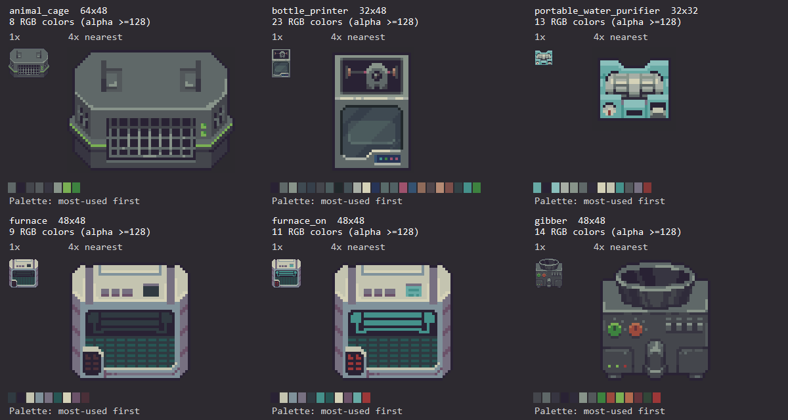
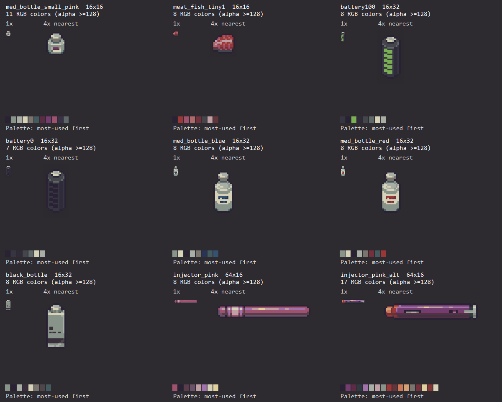

# 原版物品风格参考：机器与小型物品

本页是素材任务的选型参考。图像来自本机原版资源，提取日期、版本哈希及统计口径见 [REFERENCE.md](REFERENCE.md)。结构描述是对样本的观察，制作要求是本工作区约定，不代表原版作者发布的官方美术标准。

## 选参考的方法

每个新物品至少指定一个**结构主参考**：视角、轮廓、体量和部件分区从它出发。新增材质时再选材质参考，例如鼠笼外壳＋灌装机玻璃；两者借鉴内容分别记录。不要把数张不同投影、不同尺寸的参考部件直接缩放拼接。

机器优先按用途和体型选参考；小物件优先按瓶、罐、电池、长条器具、原料等结构选参考。颜色相近但用途和轮廓不同的物品，不宜作为唯一参考。

图板中每张同时有1×原生图和4×最近邻图，下面的色板按主体像素使用量排序；每个色块大小相同，不表示面积比例。阅读器若自动缩放整张图，屏幕上的“1×”也会被缩放，精确查看应打开PNG按100%显示。原始单图链接可直接用于后续任务。

## 一、机器

| 主参考 | 原生尺寸／主体RGB数 | 适合借鉴 | 具体结构观察 |
|---|---|---|---|
| [animal_cage](evidence/native/Sprite/animal_cage.png) | 64×48／8色 | 笼具、箱体、以原鼠笼为基础的改装 | 顶盖大色块，能看到顶面和前面；前侧规则格栅；两侧孔洞、灯和绿条以少量像素表达 |
| [bottle_printer](evidence/native/Sprite/bottle_printer.png) | 32×48／23色 | 立式加工设备、带观察窗的机器 | 上部工作腔、下部玻璃门、底部小指示灯；玻璃有方向明确的色带与边框 |
| [portable_water_purifier](evidence/native/Sprite/portable_water_purifier.png) | 32×32／13色 | 小型桌面设备、外露功能模块 | 青绿色壳体围绕浅色功能组件；底部保留按钮/接口；各部件边界明确 |
| [furnace](evidence/native/Sprite/furnace.png) | 48×48／9色 | 立式工业机器、炉体、封闭加工舱 | 浅色顶盖和暗色前部形成分区；门和下方通风格是主要结构；边角有层次但没有满面碎纹理 |
| [furnace_on](evidence/native/Sprite/furnace_on.png) | 48×48／11色 | 工作状态差分 | 与关机图保持外形，通过局部青色/红色改变显示状态 |
| [gibber](evidence/native/Sprite/gibber.png) | 48×48／14色 | 机械投料口、绞碎设备、私人改装零件 | 顶部椭圆入口表达深度，前面有成组按钮和操作部件；主要机壳仍是连续暗灰面 |

### 轮廓和视角

- 机器不必全部强制成同一45°等距视角。鼠笼能看到较宽顶盖，炉子更偏正面，投料口由椭圆表达；沿用选定主参考的投影关系。
- 先决定顶面、正面和侧面各占多少像素，再布置部件。新装发电盒或观察窗也应服从同一视角。
- 原版机器常有倒角、底座和明确边框；这些是最终网格上的阶梯形状。不要把每条边都加亮一圈，导致外壳像描了白边。
- 大机器也需要大面积连续外壳色块。用结构分区说明用途，而不是把整张图铺满零件。

### 材质和亮度

灰色金属可从鼠笼与gibber取色，保留偏冷/带紫的暗部；涂装外壳参考净水器或炉子。不同材质不必共享完全相同的色板。

| 材质参考 | 可复用的实际RGB | 使用要求 |
|---|---|---|
| 鼠笼外壳 | `#292234 #373541 #44464C #53585B #5F6868 #88948A` | 用于深边、阴影、主体面与局部亮边，具体面积参照原图 |
| 鼠笼绿条/灯 | `#3D823F #7AB053` | 小面积强调，保持与外壳的明度关系 |
| 净水器青色涂装 | `#45918B #67AAA5 #8ABFBB` | 适合相近材质的暗/中/亮色层次，不自动替换整机所有灰色 |
| 净水器浅色部件 | `#A8AEA5 #C4C4B0 #D5D2B8` | 参考浅色模块；亮部仍有色相，不能统一换纯白 |

这些是从完整调色板中抽出的用途参考，不是让每张机器同时使用全部颜色。完整RGB和使用量在 `evidence/sprite-metrics.json`。

玻璃参考bottle_printer：可见大块深色、受控的斜向反光和清楚边框。玻璃舱中的部件仍要读得清；半透明效果通常可通过合成后的颜色表达，不必让库存背景透进机器。与实际Alpha有关的要求见 [SCALING.md](SCALING.md)。

### 功能细节

- 格栅采用有规则的线宽和间隔。先在原生尺寸安排可用的行列数，再画格栅，不从高清网格任意抽样。
- 把手、通风孔和绿灯的辨识度来自位置与几何关系，不是高光数量。保留原版部件时应锁定实际像素。
- 灯、按钮、接口可以是1～数个像素，但应形成可辨认的组。随机亮点不等于螺丝或划痕。
- 改装设备先保留原机壳的轮廓和投影，再新增少量有功能的固定板、线缆或外置模块。可用材质/连接方式表达“私人改装”，不用大幅增加全图色数和碎点。

### 机器状态差分的原版实例

逐像素比较本次原图：`furnace → furnace_on` 有 **192个RGBA像素变化，Alpha变化为0**，画布均48×48。这说明这个样本通过局部颜色表现工作状态，并未重画或缩放整个炉体。

新机器差分按自己的功能划定变化掩膜，例如电量灯、窗口内的动物、液面；不要求套用192这个数字。主体位置、共享结构与画布仍必须保持。

## 二、小型物品

| 主参考 | 原生尺寸／主体RGB数 | 适合借鉴 | 具体结构观察 |
|---|---|---|---|
| [med_bottle_small_pink](evidence/native/Sprite/med_bottle_small_pink.png) | 16×16／11色 | 小药瓶、小型容器 | 瓶盖、瓶肩、浅色瓶身、紫色标签在极小范围内分层；辨识不依赖文字 |
| [med_bottle_blue](evidence/native/Sprite/med_bottle_blue.png) | 16×32／8色 | 细长药瓶 | 深轮廓、浅灰绿瓶身、瓶盖和少量蓝标签像素 |
| [med_bottle_red](evidence/native/Sprite/med_bottle_red.png) | 16×32／8色 | 同系列药剂变体 | 延续同类容器语言，红色标签区别用途；不是每种药都重新设计瓶体 |
| [black_bottle](evidence/native/Sprite/black_bottle.png) | 16×32／8色 | 包装瓶、标签型消耗品 | 方正长身、收窄瓶口、暗色标记；主要区域保持连续色块 |
| [battery100](evidence/native/Sprite/battery100.png) | 16×32／8色 | 电池、能量容器 | 顶部端子说明立体结构，绿色分段条说明电量 |
| [battery0](evidence/native/Sprite/battery0.png) | 16×32／7色 | 空电状态 | 保持同一轮廓，电量条变暗，仍可识别同一电池 |
| [injector_pink](evidence/native/Sprite/injector_pink.png) | 64×16／8色 | 细长药剂器具 | 端部、接环和长条主体沿轴向分段；不是把方形物品横向拉长 |
| [injector_pink_alt](evidence/native/Sprite/injector_pink_alt.png) | 64×16／17色 | 带机械结构的细长器具 | 除主体外有窗口、接头和不同材料，颜色预算高于简单款 |
| [meat_fish_tiny1](evidence/native/Sprite/meat_fish_tiny1.png) | 16×16／8色 | 小块肉类、有机原料 | 外轮廓不规则，内部短色带表达肉纹；这种纹理不可直接套到金属外壳 |

这里“小型物品”按功能和细节结构分类，不表示所有画布都是1×1格；64×16的细长物品有较长画布，但垂直细节预算仍很小。

### 轮廓优先

- 药瓶先保证瓶盖、瓶颈/瓶肩和瓶身区别；电池先保证端子和柱形轮廓；原料先保证外形。缩小后只剩一块亮斑，应先修轮廓，而不是继续加标签。
- 对同系列物品，保留一致的比例、位置和底部基线。可以改变标签色、内容物或局部结构，不能每个变体都裁切到各自包围盒再铺满画布。
- 小物件不必机械填满所有像素。原版小粉药瓶主体138/256像素，电池主体284/512；留白和窄身也是体型的一部分。
- 标签通常是有组织的几何色块，不应在16×16里塞实际长文字。用户确需可读字时，另确认更大画布或UI文字方案。

### 可直接引用的同系列配色

蓝/红药瓶共有的主体色：

`#88948A #D5D2B8 #292234 #A8AEA5 #79746E #435A5F`

蓝色标签：`#273456 #355271`；红色标签：`#74313B #9C3738`。

这组样本适合“保留容器，改变药品识别色”的设计。颜色顺序不代表具体绘制层次；应看对应原图中实际分布。小粉药瓶有11色，说明16×16并不强制比16×32更少色，仍需看材质和内容。

普通电池配色：

`#373541 #292234 #7AB053 #2F2B3A #44464C #5F6868 #D5D2B8 #A8AEA5`

其中绿色用于电量条，亮色用于端部。设计新电池时可先锁定端子、柱体及轮廓，再处理状态条。

### 小物件状态差分的原版实例

`battery0 → battery100` 仅 **50个RGBA像素变化，Alpha变化为0**，两张均16×32。新的空/满、开/关版本应先考虑局部状态区域；不要把发光效果当成全面提亮物体。

这些差异数字由工具重算记录在 `evidence/style-state-diffs.json`，仅描述这两组样本，不作为全部素材的合格比例。

## 三、制作前后如何使用本页

1. 在任务记录中写明结构主参考，例如“animal_cage的64×48壳体和投影”，避免只写“参考原版”。
2. 指定材质参考，例如“bottle_printer的玻璃反光”；不同投影的部件不能直接拼接。
3. 列出要保留的轮廓、色块、格栅/瓶口等识别点，以及允许变化的区域。
4. 在最终网格设计。生成的大图若只是概念参考，按缩放规范转为经过修整的原生精灵。
5. 把新图和选定原版放在同样的深色背景，以**同样倍率**并排检查；不要分别自动缩放成相同展示宽度来掩盖体型差异。
6. 分别检查主体比例、深边宽度、亮部面积、颜色用途、重复细节、关键识别点和状态对齐；通过后再做游戏内显示验证。

机器应能指出主要功能区；小物件应能指出轮廓与身份标记。若只在放大图上成立、回到1×就变成碎点，需要回到原生像素布局修改。
